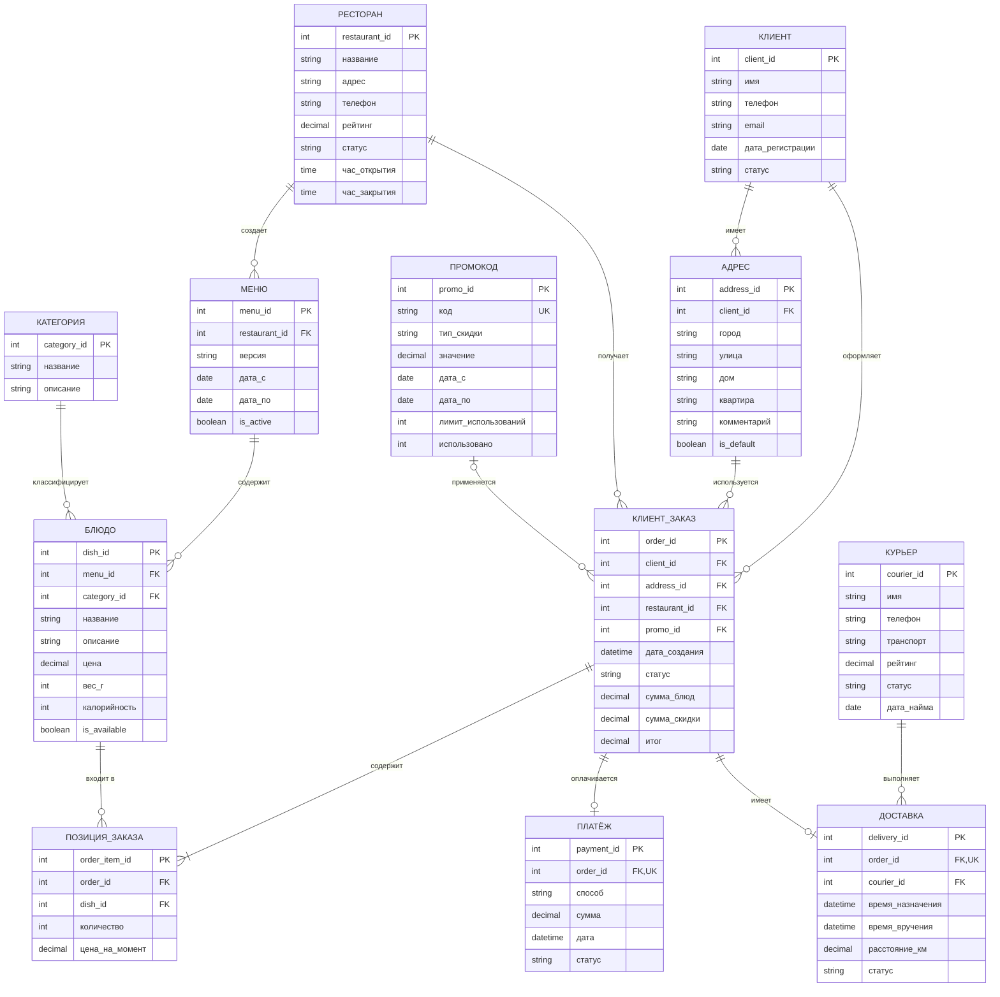

# Логическая система базы данных

## Система доставки еды

Данная диаграмма описывает логическую структуру базы данных системы доставки еды.

## ER-диаграмма

## Обозначения

| Обозначение | Значение |
|---|---|
| PK | Первичный ключ (Primary Key) |
| FK | Внешний ключ (Foreign Key) |
| UK | Уникальный ключ (Unique Key) |
| `||` | Ровно один |
| `o|` | Ноль или один |
| `o{` | Ноль или много |
| `|{` | Один или много |

## 3. Основные связи между сущностями

1. Клиент — Адрес: один ко многим (1:N).
2. Клиент — Заказ: один ко многим (1:N).
3. Ресторан — Меню: один ко многим (1:N).
4. Меню — Блюдо: один ко многим (1:N).
5. Категория — Блюдо: один ко многим (1:N).
6. Ресторан — Заказ: один ко многим (1:N).
7. Заказ — Позиция заказа: один ко многим (1:N).
8. Блюдо — Позиция заказа: один ко многим (1:N).
9. Курьер — Доставка: один ко многим (1:N).
10. Заказ — Доставка: один к нулю или одному (1:0..1).
11. Заказ — Платёж: один к нулю или одному (1:0..1).
12. Промокод — Заказ: один ко многим (1:N).

## 4. Ограничения целостности данных

Для обеспечения корректности данных предусмотрены следующие ограничения:

- PRIMARY KEY — уникальная идентификация каждой записи.
- FOREIGN KEY — обеспечение ссылочной целостности между таблицами.
- UNIQUE — уникальность кода промокода, а также order_id в таблицах «Доставка» и «Платёж».
- CHECK (цена > 0) — цена блюда должна быть положительной.
- CHECK (количество > 0) — количество блюд в заказе должно быть больше нуля.
- CHECK (рейтинг BETWEEN 0 AND 5) — рейтинг должен находиться в диапазоне от 0 до 5.
- CHECK — проверка допустимых значений статусов заказов, доставок и платежей.
- ON DELETE RESTRICT / CASCADE — управление удалением связанных записей в зависимости от назначения сущности.

